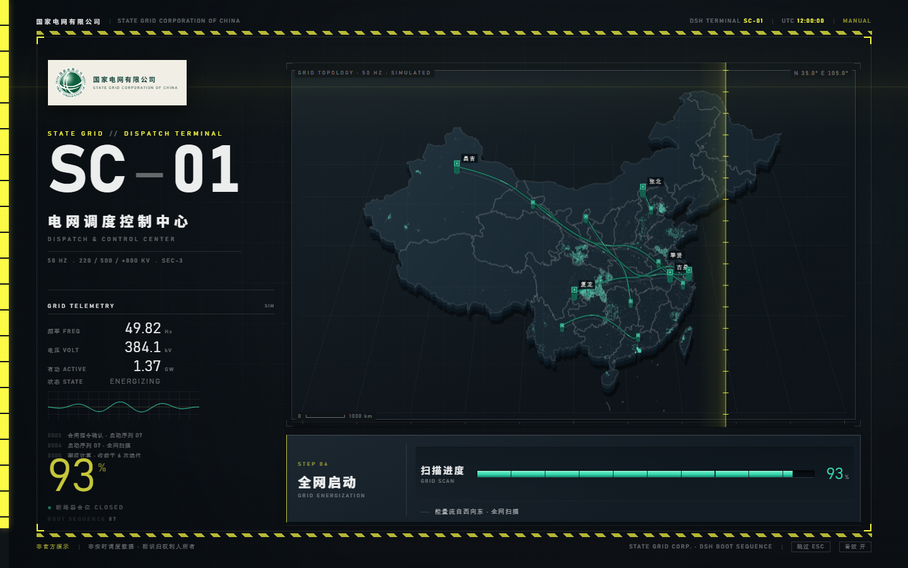
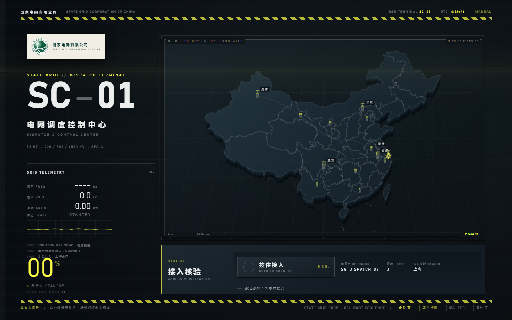

# dsh-boot-grid-zmd

> 国家电网有限公司 × 明日方舟：终末地（ZMD）风格 · DeepSeek Harness 启动动画
> 交互式四拍启动序列：**按住接入 → 调度指令复诵 → 拖动合闸 → 全网启动**



## 这是什么

打开 DSH 网页界面时，铺一层全屏启动动画：一台工业调度终端 SC-01 上电，调度员按住接入、复诵一条特高压线路的送电指令、把断路器推到「合」，然后电流自西向东点亮全国电网。

动画本体是纯静态 HTML/CSS/JS，可以直接双击打开；插件只是把它装进一个全屏 iframe，并提供三条退场兜底。

## 直接看

```bash
start dsh-boot-grid-zmd/assets/index.html          # 手动模式（默认）
start "dsh-boot-grid-zmd/assets/index.html?auto=1" # 自动演示（约 16 秒）
```

启动屏底部有 **模式 手动 / 模式 自动** 切换：默认手动，点一下即可改为自动演示；选择会写入 cookie，下次启动保持。调试定位：`?jump=access|order|close|boot|done`。

## 交互

| 步骤 | 怎么做 | 反馈 |
|---|---|---|
| 01 接入核验 | 按住按钮 1.2 秒后松开 | 圆环收拢、计时、嗡鸣；成功转绿，中断红框抖动 |
| 02 调度指令 | 点击「复诵」，再点「执行」 | 回显逐字打出、变绿；执行前「执行」不可用 |
| 03 合闸并网 | 拖动把手到「合」（≥90%）；方向键也可 | 电压 0→525.0 kV 实时跟随；未到位弹回 |
| 04 全网启动 | 等待 | 自西向东扫描、城市点亮、频率稳定 50.00 Hz |
| 收尾 | 点击任意处 | 420ms 黄扫 → 黑场 → 完成页 → 交付给 DSH（覆盖层内 3 秒自动进入） |
| 模式 | 底部「模式 手动 / 自动」 | 默认手动；切换后写入 cookie，下次启动保持；自动播放中任何真实操作都会转为手动 |
| 定位 | 底部「定位 关 / 开」 | 默认关；开启后按省级电网高亮；非国网经营区回退全国视图 |

- `Esc` 任意阶段跳过；音效可关；`prefers-reduced-motion` 有降级。
- 地图节点可悬停：经纬读数跟随，显示站名与电压等级。
- 空间层次：地图是带石墨侧壁的实体板，城市点/线路/节点分层；数据层通电后抬起，面板与控件有统一的上亮下暗结构（对比见 [docs/depth/](docs/depth/optimization.md)）。

## 定位与经营区

- **默认关闭**；只有点「定位 开」才请求浏览器坐标。坐标只在本机做省级归属，不写日志、不上传、不持久化；只记住开/关偏好。
- 定位命中后高亮所在省、标出实际坐标，并在左侧显示「接入区域 上海」、地图右下显示「上海电网」（示意标签）。
- 国网经营区按公开的 26 个省 / 国土面积 88% 口径；广东、广西、云南、贵州、海南（南方电网经营区）与港澳台显示「非国网经营区 · 全国视图」，不冒充接入。
- 内蒙古标注「蒙东/蒙西以供电营业区为准」；省界为简化数据，边界附近可能有误差。拒绝授权或定位不可用时自动回退全国视图。
- DSH 端口每次变化时，浏览器可能按新的 origin 重新询问定位权限；这是浏览器的权限模型，不是设置丢失。



## 装进 DSH

**同一时间只应有一个启动屏插件生效。** 如果已经装着 `dsh-boot-grid`、`dsh-boot-animation` 等其他启动屏，先从 profile 的 `bundles` 里去掉，否则两层全屏会互相遮挡。

```bash
# 从 GitHub 安装（推荐）
dsh plugin add github:xingyanghaifu/dsh-boot-grid-zmd

# 或本地 link 开发
dsh plugin add link:E:/path/to/dsh-boot-grid-zmd
```

然后在 profile 的 `package.json` → `dsh.profile.bundles` 里加入 `"dsh-boot-grid-zmd"`（或使用 DSH 设置里的插件管理器安装这个目录）。刷新页面即可在开机时看到。

退场兜底：iframe 内 `boot-grid-zmd:done/skip`、外层 Esc、9 秒载入看门狗、60 秒总时长上限；完成页 3 秒无人操作自动交还。

## 目录

```
assets/
  index.html      页面骨架
  boot.css        视觉系统（token / 版式 / 状态）
  boot.js         状态机 + 地图 + 交互 + 音效
  china-data.js   省界 + 5153 个城市点 + 省份/经营区元数据（公开数据）
  logo-mark.png   官方组合标识（公开 PNG，非矢量源文件）
  screen.js       全屏 iframe 覆盖层
entry.js          Host：静态资源白名单 + index 注入
smoke.mjs         离线冒烟测试
tools/            截图 / 全流程交互测试 / 子路径服务
docs/
  design.md             设计说明（概念、token、动效、交互、ZMD 对照）
  official-crosswalk.md 官方文档对照记录（逐项依据、可信度、风险）
  acceptance.md         自检与验收记录
  depth/                空间层次优化：说明、前后对比、回归结果
  shots/                各阶段历史截图
```

## 设计依据

- 终末地视觉语言：`docs/research/zmd-style.md`（本地参考样片源码 + 像素取样，非凭印象）。
- 国家电网官方文档：`docs/research/state-grid-official.md`（2026-11-09 取证，标注公开原文/二手转载/未核实）。
- 关键取舍：全直角、1/2/6px 三档线宽、黄≤6%、中文不进超大拉丁字标位；绿只承担「认证/带电/正常」一个语义槽。

## 声明

本项目为非官方演示，与国家电网有限公司、鹰角网络均无关联。标识与名称归权利人所有；界面中的终端号、调度员编号、电压/频率/有功读数为演示数据（`SIM`），不是实时调度信息。地图为公开省界数据的示意重绘，非标准地图，不用于公开发布。

## License

MIT（代码）；标识、名称、地图数据权利归各自权利人。
